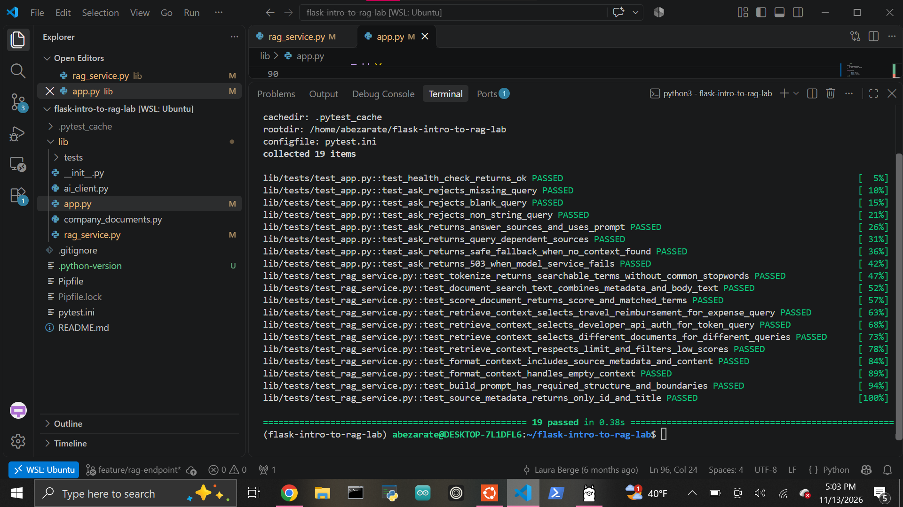

## Completed Implementation

This lab implements a simplified Retrieval-Augmented Generation (RAG) workflow using Flask and approved company documentation.

The `/api/ask` endpoint now:

- Validates incoming JSON and rejects missing, blank, or non-string queries.
- Searches approved company documents using keyword-based retrieval.
- Scores documents according to matching search terms.
- Selects only relevant, query-dependent context.
- Formats retrieved documents into a structured context block.
- Builds a grounded prompt containing instructions, context, the user's question, and response requirements.
- Calls the provided AI client only when relevant context exists.
- Returns the generated answer along with source IDs and titles.
- Returns a safe fallback when no relevant documentation is found.
- Returns HTTP `503` when the model service raises a `RuntimeError`.

### Test Results

All provided automated tests pass successfully:

```text
19 passed
```



## Reflection

This lab helped me understand that RAG is more than simply sending a question to an AI model. The application first determines what approved information is relevant, formats that information as context, and then asks the model to answer using that evidence.

The most important part for me was seeing how retrieval affects the final response. Different questions select different documents, and if no appropriate documentation exists, the application avoids calling the model entirely. That makes the workflow more controlled and reduces the chance of producing unsupported answers.

I also gained more practice separating responsibilities between files. `rag_service.py` handles retrieval and prompt construction, while `app.py` coordinates HTTP validation, the RAG workflow, model calls, and API responses.

## Fictional Shift Notes

**Fictional internal development shift**

- Reviewed the starter RAG architecture and provided tests.
- Implemented query tokenization and stopword filtering.
- Added searchable document text using titles, categories, tags, and body content.
- Implemented document scoring and query-dependent retrieval.
- Added context formatting, structured prompt generation, and source metadata.
- Completed `/api/ask` request validation and RAG workflow coordination.
- Added safe no-context behavior and model-service error handling.
- Verified the complete implementation with the provided pytest suite.
- Final result: `19 passed`.